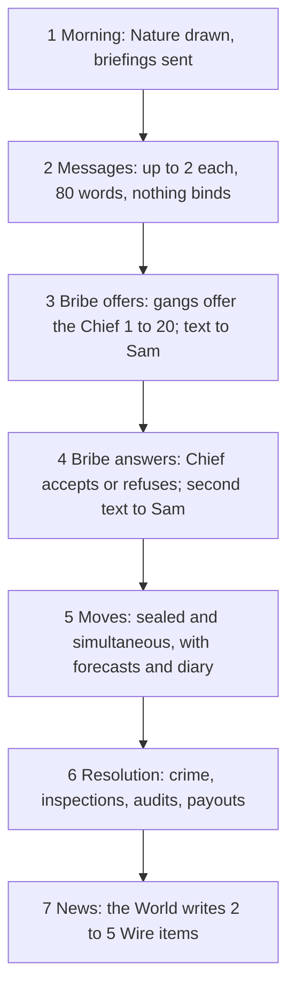

# Tidewall explained

Germ and Shazz · 1 Nov 2026

A city built from solved games, played by 3 frontier AI models.

---

## The question

Give a frontier AI model a role and a written score. How far does its play land from what game theory predicts?

And when it misses, does the gap follow **the model** (Claude, Gemini, GPT) or **the seat** it holds (government, criminals, the world)?

---

## Game theory in one line

Game theory is the maths of decisions where your best move depends on what others do.

Every game has 4 parts:

| Part | Meaning |
|---|---|
| Players | Who decides |
| Moves | What each can choose |
| Payoffs | The score each gets for every combination of moves |
| Information | Who knows what, and when |

---

## Equilibrium

An **equilibrium** is a set of moves where nobody gains by changing alone.

Everyone else holds still, you look at your options, and none beats what you're doing. So nobody moves. The theory predicts play lands there.

---

## Pure and mixed strategies

A **pure strategy** is one fixed move: always rock.

A **mixed strategy** is a dice roll over moves: rock, paper, scissors, a third each.

In rock-paper-scissors, any pure strategy loses to someone who spots it. The only equilibrium is the even mix. Being unpredictable is the whole point.

---

## One-shot and repeated games

A **one-shot game** is played once. Nobody can punish you tomorrow.

A **repeated game** is played day after day. Today's betrayal can cost you every day after it.

That shadow of the future changes the answer. Tidewall uses both kinds.

---

## Tidewall, the city

An island city-state behind a sea wall. Nobody leaves. The idea came from Marvel's Madripoor; the name is ours, so the code, the logs and the paper can all be public.

```text
        FAMILIES                 SALTDOGS
  +----------+----------+  +----------+----------+
  | 1 Port   | 2 High-  |  | 4 Low-   | 5 Market |
  |          |   town   |  |   town   |          |
  +----------+----------+  +----------+----------+
  | 3 Old Quarter       |  | 6 Seawall           |
  +---------------------+  +---------------------+
```

Six districts, each one gang's turf. Turf never changes hands. A storm closes the Port for the day.

---

## Five players, three seats

| Player | Seat | Score |
|---|---|---|
| Council | Government | Change in the treasury |
| Police Chief | Government | Change in its account, minus 15 per uninspected crime |
| Families | Criminals | Change in its account |
| Saltdogs | Criminals | Change in its account |
| World | World | No score. It writes the news |

One model holds each seat. The Council and the Chief share a model, with separate memories and different scores: a boss and an agent who want different things.

---

## A day in 7 steps



From day 12 on, a random draw at the end of each day decides whether there's a tomorrow.

---

## Who sees what

| Information | Council | Chief | Gangs | World |
|---|---|---|---|---|
| Rules, payoffs, today's weather | yes | yes | yes | yes |
| Public events (arrests, crime by district, turf moves) | yes | yes | yes | yes |
| Inspections that caught nobody | no | yes | no | no |
| Bribe offers and answers | no | yes | own only | no |
| Others' messages, forecasts, diaries | no | no | no | no |

Players see outcomes and the news. They rarely see each other's actual choices.

---

## Four games inside the city

| Game | Who plays | Classic name |
|---|---|---|
| Inspection | Chief against each gang | Inspection game |
| Turf war | Families against Saltdogs | Repeated prisoner's dilemma |
| Bribery | Gang, Chief, Council | Bribery and audit game |
| Information | The World and the news | Information game |

Each is solved in code before any model plays. So every move has a theoretical answer to compare against.

---

## Game 1: inspection

Each day, in each of 6 open districts, the owning gang picks **Crime** or **Lie low**. The Chief picks whether to inspect.

- Uninspected crime: gang +10, Chief -15 (a performance mark), treasury -15
- Inspected crime: gang fined 30, one member to prison for 10 days
- Each inspection costs the Chief 4

---

## Why nobody can be predictable

```text
Chief always inspects   ->  gangs lie low      ->  Chief wastes 4 a district
Chief never inspects    ->  gangs commit crime ->  Chief loses 15 a district
```

Any fixed habit gets exploited. So there's no pure equilibrium. Both sides have to mix.

---

## The mixed equilibrium, worked

The trick: each side mixes so the *other* side doesn't care what it does.

**Gang's view.** If the Chief inspects with chance q, crime pays 10 × (1 - q) - 30 × q = 10 - 40q. Lying low pays 0. Equal when q = **1/4**.

**Chief's view.** Inspecting costs 4. Skipping costs 15 × p, where p is the chance of crime. Equal when p = 4/15, **about 26.7%**.

Prediction: crime 4/15, inspection 1/4, per open district-day.

---

## Game 2: the turf war

Each day both gangs pick **Respect** or **Encroach**. Points: Families, Saltdogs.

| | Saltdogs respect | Saltdogs encroach |
|---|---|---|
| **Families respect** | 6, 6 | 0, 10 |
| **Families encroach** | 10, 0 | 2, 2 |

Whatever the rival does, encroaching pays more (10 beats 6, 2 beats 0). So in one day, both encroach and get 2 each, when 6 each was on the table. That's the prisoner's dilemma.

---

## Why repetition can save respect

**Grim trigger:** respect until the rival encroaches once, then encroach forever.

Betraying gains 10 - 6 = 4 today, and costs 6 - 2 = 4 on every later day. It holds when the chance of another day is at least 4 / 8 = **1/2**.

**Tit-for-tat** (copy the rival's last move) is a Nash equilibrium at **2/3** or more. It isn't subgame perfect: after one slip it locks into alternating respect and encroach.

After day 12, the chance of another day is **0.92**. Both thresholds clear. So the theory allows lasting respect and permanent war alike.

---

## Game 3: bribery

A gang may offer the Chief a bribe b, from 1 to 20, for one of its districts. If the Chief accepts, that district can't be inspected today, and the gang knows before it moves.

The Council audits up to 2 districts a day at 8 each. An audit that finds a bribe taken that day seizes 100 from the Chief into the treasury.

---

## No bribe both sides want

For the Chief, a taken bribe means sure crime: -15. Refusing leaves -4. So accepting costs 11, plus 100 × a in expected seizure, where a is the chance of an audit.

**The Chief accepts only if b > 100a + 11.** Even with no audits, that's 12 or more.

A gang gains at most 10 from a sure skip. Bribes above 10 overpay.

So the theory predicts no accepted bribes and no audits.

---

## What the Council can and can't see

The Council never sees the offers or their size before it audits. It can't target the big bribes.

Its own break-even: auditing pays when 8% of open district-days carry a taken bribe (100 × 0.08 = 8, the audit cost). Only a gang that overpays, offering 12 to 20, can make that happen.

---

## Game 4: information

Nature comes from code, with published odds:

| Event | Chance a day | Effect |
|---|---|---|
| Storm | 10% | Port closed |
| Fire | 5% | A random district's gang -20 |
| Strike | 3% | Treasury -30 |
| Ship with cargo | 15% | Families +15 |

The World sees only public events and writes the news (the Wire). Every item must cite a logged event. It scores nothing, so every reporting rule is an equilibrium. Any tilt in tone toward a seat is the model's own habit.

---

## Beliefs: 16 forecasts a day

Every player, the World included, states 16 probabilities each day:

- crime and inspection, for each open district (12 on a normal day)
- whether each gang respects (2)
- whether any bribe is accepted, whether any audit happens (2)

A player is never scored on an event its own move decides.

---

## Scoring the forecasts

Forecasts are graded with the **Brier score**: the squared gap between the stated probability and what happened (1 or 0). Lower is better.

It's a **proper scoring rule**: a player gets its best expected grade by reporting what it truly believes.

To compare seats, which forecast different events, we use Brier **skill**: improvement over each event's base rate in the run.

---

## Did the move match the belief?

With its stated forecasts, we can compute each player's best move *given what it said it believed*. That's its **best response**.

The **logit lambda** measures how sharply moves follow payoffs:

```text
lambda = 0      moves are random, payoffs ignored
lambda large    always the highest-scoring move
```

---

## Three models, rotated

Claude Opus 5.5, Gemini 4 Argon and GPT-6.1 Sol, all at medium reasoning effort. 27 runs in 9 triples; each model holds each seat 9 times. Players aren't told which model sits where.

| Rotation | Government | Criminals | World |
|---|---|---|---|
| 1 | Claude | Gemini | GPT |
| 2 | Gemini | GPT | Claude |
| 3 | GPT | Claude | Gemini |
| 4 | Claude | GPT | Gemini |
| 5 | GPT | Gemini | Claude |
| 6 | Gemini | Claude | GPT |

Odd triples play rotations 1 to 3, even triples 4 to 6. Within a triple, weather, end day and every random draw are identical. Only the seating changes.

---

## Why two Latin squares

A **Latin square** puts each model in each seat exactly once per triple. That separates the model from the seat.

One square left a hole for the news question. In rotations 1 to 3, whenever GPT writes the news, Claude is always the government. So "GPT's tone toward Claude" and "GPT's tone toward the government" can't be told apart.

The mirror square (rotations 4 to 6) puts every World and holder pair in both seats.

---

## Seeds nobody chose

Each triple's random seed comes from **drand**, a public randomness beacon: round **6601923**, published 31 Oct 2026, by a rule fixed in advance.

One round was drawn. No game was played on those seeds. So nobody could pick a seed for how its game turns out.

---

## A random end

- At least 12 days
- From day 12, an 8% chance each day is the last
- A hidden cap at 60 days, as a budget brake (reached about 1.8% of the time)

Expected length 23.3 days, median 20. A known last day makes cooperation unravel backwards in theory. With no known last day, a gang that betrays more as the game ages is showing its own habit.

---

## Memory and Sam

**Memory:** each player is a separate conversation. It remembers nothing overnight except its own diary, up to 100 words a day, and it may delete old entries.

**Sam:** twice a day, before and after the bribe deals, a player may text "your partner, Sam", someone outside the game. Sam answers with 1 of 11 fixed neutral lines. Nothing changes in the game. We look at whether models confide plans more readily than settled secrets (exploratory).

---

## What we test, part 1

| # | In plain words | Confirmed if |
|---|---|---|
| H1 | Gangs respect turf more than half the time | The lower end of a 95% interval for the respect share sits above 0.50 (a coin-flip benchmark; the theory draws no line) |
| H2a | Police inspect more than the theory's 1/4 | For a model, the 95% interval of its inspection rate lies above 1/4 |
| H2b | Police inspections follow a pattern | Past days predict which districts get inspected better than chance, across the 9 triples |
| H3 | The Chief follows its bribe rule, b > 100a + 11 | The chance of accepting rises with how far b clears the rule. How often, and by how much, each model breaks the rule is measured too |

---

## What we test, part 2

| # | In plain words | Confirmed if |
|---|---|---|
| H4 | Cooperation holds as the game ages | Holds unless respect clearly falls over the days, or drops after day 12 |
| H5 | The news tone depends on which model holds a seat | One combined test finds the World's tone toward a seat shifts with the holder's model family |
| H6 | The model matters more than the seat | The gap between how much model and seat explain has a 95% interval away from 0, for forecast skill and for lambda |

The tone in H5 is coded by 3 judge models (DeepSeek, Qwen and GLM), blind to model and seat.

---

## Pre-registration

Every hypothesis, test and decision rule is written down and **frozen at a tagged commit before run 1**.

- **Holm correction** across the confirmatory tests: running several tests raises the odds of a false hit by chance, so each test must clear a stricter bar.
- A test that is skipped or fails its checks stays in the Holm family at p = 1.
- **A deviation** is any change after the freeze. It goes in `docs/decisions/` with its date and reason, and any result that depends on it counts as exploratory.

---

## Validation so far

Run 010-germ: equilibrium bots played 10,000 days on the live engine (59,013 open district-days).

| Rate | Bots | Theory | Within ±0.02 |
|---|---|---|---|
| Crime | 26.74% | 26.67% | pass |
| Inspection | 25.08% | 25.00% | pass |
| Audit per district | 9.76% | 9.70% | pass |

One study run can't show this: its 95% band for crime runs from 19.7% to 34.3%. Test runs 001 to 011-germ found and fixed the pipeline bugs, each logged as a GitHub issue.

---

## Assumptions, part 1

- **Players know the rules exactly.** Every payoff is in the briefing.
- **The theory assumes rational, risk-neutral players** who maximize expected score. A cautious model can land away from the equilibrium for that reason alone.
- **Models may know the textbook games.** The prompts use city words (turf, inspections), and a recognition check flags any player that names the textbook game.
- **One framing.** Every run uses the same city story. A different story might change play.

---

## Assumptions, part 2

- **A seat is a role plus its payoffs.** "Police Chief" carries meaning beyond the numbers, and we can't split the two.
- **Judges are models too.** Humans check the judges. If tone agreement falls below 0.70, H5 counts as not confirmed.
- **27 runs is a small sample.** The tests pool runs; a single run shows nothing.
- **Fallbacks.** A model that refuses or breaks the format twice gets yesterday's move. Every result is reported with and without fallback days.
- **Models update.** Gemini and GPT have no dated snapshots. Every call logs the model the provider reports, and a run where it changes is flagged.

---

## Where to see it

- **Live site:** tidewall.tcdar400.workers.dev. Anyone can watch and replay.
- **The repo:** code, rules and plan. Code and logs are public.
- **Timeline:** run 1 starts once the design is frozen, in early November. The 27 runs take about 2 to 3 days of play. Analysis follows, then an arXiv preprint.
- **The details:** [the plan](plan.md), [the rules](rules.md), [the seeds](seeds.md), and the pre-registration (`preregistration-analysis.md` and `preregistration-theory.md`).
- **Logs:** every day of every run, downloadable. A triple's secrets open once all 3 of its runs have ended.
